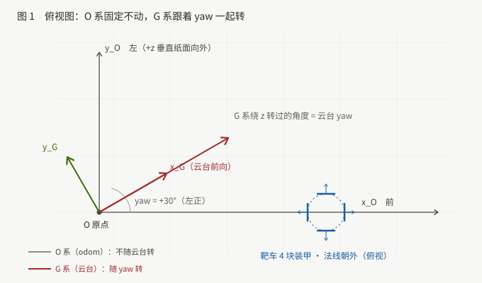
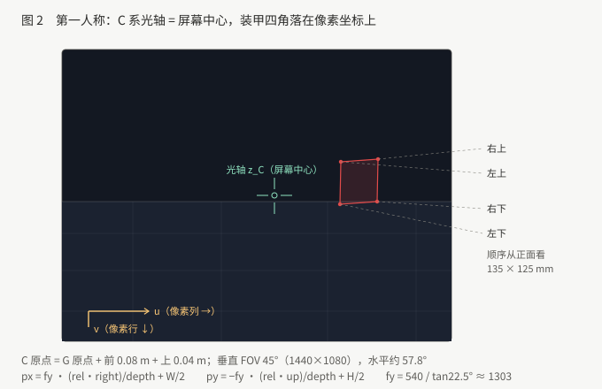

# 画面上怎么看「固定坐标系」和「变化坐标系」

> 看完这一页，你能指着画面说出：哪套轴永远不动、哪套轴跟着云台转、屏幕上那几条线和数字分别属于哪套系。

## 一句话结论

**五套系，两静三动。**

| 坐标系 | 原点 | 会不会转 | 你从哪看到它 | 谁在用 |
|---|---|---|---|---|
| **W** 世界 | 场地原点 | 不动 | 地面网格、距离标记 | 内部基准 |
| **O** odom | 云台旋转中心 (0, 0, 0.65) | **只平移，不旋转** | 勾「显示坐标系」的轴（固定轴） | **`/aim_sim/armors` 的四角都在这里** |
| **G** 云台 | 同 O | **随 yaw / pitch 转** | 云台模型本身、底部 yaw/pitch 读数 | 云台前向、pitch 限位 |
| **C** 相机 | G + 前 0.08 m + 上 0.04 m | 随云台一起转 | 右上角画中画 + 十字线 | 可见性判定、投影像素 |
| **M** 装甲 | 每块装甲中心 | 随靶车平移/自转，还带 15° 倾角 | 装甲贴图与命中矩形 | 四角点、法线 |

**记忆口诀**：odom 只是"把世界搬到云台脚下"，**方向永远不跟着云台转**；跟着转的只有 G 和 C。



## 图 1 怎么读（三步）

1. **灰线 = O 系**：`x_O` 永远指向车头正前方，`y_O` 永远指向左侧。云台怎么转，它俩纹丝不动。
2. **彩色 = G 系**：`x_G` 是云台前向，`yaw = +30°` 时它从 `x_O` 向左偏了 30°。**yaw 转的就是这套轴**。
3. **蓝色方块 = 装甲**：它的位置记在 O 系里。所以**云台转了多少度，装甲四角的数值一个都不变**——变的只是「哪些装甲进了相机画面」。

> 这也是为什么你的节点可以直接 `yaw = atan2(cy, cx)`：因为 O 系轴向和世界一致、yaw 零点就是 +x，不需要再减云台角。



## 图 2 怎么读（相机把 3D 投成 2D）

- **屏幕中心 = 光轴**，也就是 C 系的 +z。十字线就是它。
- 垂直 FOV **45°**、分辨率 1440×1080，所以 `fy = 540 / tan22.5° ≈ 1303` 像素；水平约 **57.8°**。
- **四个角点**按「从正面看：左上 → 右上 → 右下 → 左下」的顺序给出，矩形 135 × 125 mm，**不是灯条尺寸**。
- 换算关系（单位米）：

```
px =  fy · (rel·right) / depth + W/2
py = −fy · (rel·up)    / depth + H/2
```

`py` 前面有负号，所以 **v 轴向下为正**；这也是 ROS 相机惯用的图像坐标系。

## 在仿真画面里，实际怎么看这三套

| 想看 | 操作 | 看到的是 |
|---|---|---|
| 固定轴 | 左侧「显示坐标系」 | 云台旋转中心处的三色轴（**注意：它是 3D 场景的颜色约定，不等于 RM 轴**，见下面警告） |
| 四角数值 | 左侧「显示装甲角点数值」 | 表格里全是 **O 系** 的 x/y/z（米），已减去 0.65 m 高度 |
| 相机系 | 「相机画中画」+ 十字线 | 学员节点真正"看到"的画面，只有**四端都在画面内**且朝外的装甲才可见 |
| 云台实际角 | 底部遥测 `Yaw / Pitch（度，上正）` | G 系相对 O 系的角度 |

> ⚠️ **坐标轴颜色陷阱**：Three.js 里 X 红 / Y 绿 / Z 蓝，但它是**屏幕坐标**，对应关系是
> 红 = RM 的 **−y**（指向目标右侧）、绿 = RM 的 **+z**（朝上）、蓝 = RM 的 **−x**（指向后方）。
> 所以别看到「红色朝右」就以为 RM 的 x 朝右——RM 的 x 永远朝**前**。

## 一分钟自测（动手做一遍就懂了）

1. **不动靶，只把 yaw 用面板步进 +10°**
   → `armors` 四角数值**完全不变**；`gimbal.yaw` 变成 0.1745；画中画里可能有一块装甲消失（超出 57.8° 水平视场）。
2. **pitch 抬 5°**
   → 画中画里的地面**往下走**、靶车上移；读数变成 `pitch +5.0`（**上正**）。仿真内部存的是 −0.0873，桥接发布时取反了。
3. **云台转到 90°，正对另一块装甲**
   → 可见装甲集合换人，`armors.armors` 数组长度可能从 1 变 0（侧面装甲灯条不全在画面内就不发布）。

## 三个最容易搞错的地方

1. **odom 不是云台系**。它只把原点搬到云台脚下，**轴方向和世界一样**。所以四角数值与云台角度无关；真正随云台转的是 G/C 系里的"前向"和"像素投影"。
2. **pitch 两套符号**。ROS 侧发布 `pitch` 是**上正**；仿真内部是**下正**（`forward = (cos p·cos y, cos p·sin y, −sin p)`，p 为正即低头）。桥接里做了取反，你按 ROS 约定写就对了。
   云台限位按仿真内部取 `−30° ~ +20°`，换成 ROS 上正就是 **抬头最多 +30°、低头最多 −20°**。
3. **四角顺序固定**为 左上/右上/右下/左下（从正面看），法线朝外并带 **15° 倾角**。顺序搞错会让 `solvePnP` 直接算出镜像位姿。

---

*想把 G 系/C 系的随动轴直接画在 3D 画面上（跟着 yaw/pitch 一起转），需要改十几行渲染代码；需要的话说一声就加。*
